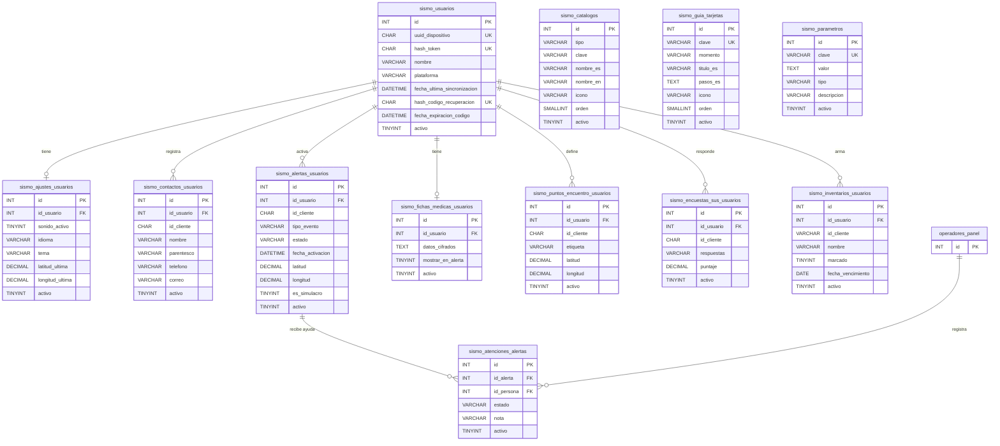

> **Nota de Transparencia:** Este documento fue generado con apoyo de Inteligencia Artificial Generativa (Claude Code) cumpliendo la Política ODTI012 del CCS.

# Base de datos de SISMO: tablas, columnas y relaciones

Diccionario de datos del backend (CodeIgniter 3 + MySQL/MariaDB). Describe las **12 tablas `sismo_*`** que guardan lo que la app tenía en el teléfono, la bitácora de ayuda del panel de monitoreo y el contenido administrable (catálogos, guía y parámetros).

- **Motor y juego de caracteres:** InnoDB, `utf8mb4`.
- **Convención de nombres (CCS):** tablas en plural y `snake_case`; claves foráneas con prefijo `id_`; fechas de negocio con prefijo `fecha_`; todo comentado.
- **Auditoría en todas las tablas:** `created_at`, `created_by`, `updated_at`, `updated_by`.
- **Borrado:** solo lógico, con `activo` (1 = activo, 0 = inactivo). No se usa `deleted_at`.
- **Fechas:** se guardan en UTC.
- **Identificadores de la app:** contactos, alertas, puntos, encuestas e ítems del kit llevan el UUID que genera la app (`id_cliente`). Así la app puede reenviar la misma operación sin duplicar registros (escritura idempotente).

---

## 1. Diagrama entidad-relación

> `operadores_panel` representa la tabla de personas que inician sesión en el sistema administrativo (operadores del panel de monitoreo). No es parte de las tablas `sismo_*`; solo se referencia desde `sismo_atenciones_alertas.id_persona`.
>
> Las tablas de **catálogos, guía y parámetros** no tienen relaciones con claves foráneas: la app guarda la **clave** del catálogo (por ejemplo `tipo_evento = 'sismo'` o los pasos de «Después del sismo» por `paso_01`…). Así, si el administrador cambia el nombre o lo oculta, los datos ya guardados no se pierden.

### Resumen de las tablas

| # | Tabla | Qué guarda | Relación |
|---|---|---|---|
| 1 | `sismo_usuarios` | Cada teléfono registrado (sin contraseña: token) | Tabla principal |
| 2 | `sismo_ajustes_usuarios` | Configuración de la app y última ubicación | 1 a 1 con usuarios |
| 3 | `sismo_contactos_usuarios` | Contactos de emergencia | 1 a muchos |
| 4 | `sismo_alertas_usuarios` | Historial de alertas SOS y métricas | 1 a muchos |
| 5 | `sismo_fichas_medicas_usuarios` | Ficha médica **cifrada** | 1 a 1 |
| 6 | `sismo_puntos_encuentro_usuarios` | Puntos de encuentro (hasta el tope configurado) | 1 a muchos |
| 7 | `sismo_encuestas_sus_usuarios` | Encuestas de usabilidad SUS | 1 a muchos |
| 8 | `sismo_inventarios_usuarios` | Mochila / kit de emergencia | 1 a muchos |
| 9 | `sismo_atenciones_alertas` | Bitácora de ayuda del centro de monitoreo | muchos a 1 con alertas y con operadores |
| 10 | `sismo_catalogos` | Listas administrables (tipos de evento, parentescos, kit, pasos, tipos de sangre) | Sin FK (por clave) |
| 11 | `sismo_guia_tarjetas` | Tarjetas de la guía de emergencia | Sin FK |
| 12 | `sismo_parametros` | Parámetros generales (número de emergencia, topes, tiempos, textos) | Sin FK |

---

## 2. Usuarios y datos de la app

Columnas de auditoría comunes a **todas** las tablas (no se repiten abajo):

| Columna | Tipo | Nulo | Por defecto | Descripción |
|---|---|---|---|---|
| `created_at` | `DATETIME` | No | `CURRENT_TIMESTAMP` | Fecha de creación |
| `created_by` | `VARCHAR(120)` | No | — | Nombre de quien creó el registro (`sistema` cuando lo crea la app o la semilla) |
| `updated_at` | `DATETIME` | Sí | `ON UPDATE CURRENT_TIMESTAMP` | Fecha de última modificación |
| `updated_by` | `VARCHAR(120)` | Sí | — | Nombre de quien modificó por última vez |

### 2.1 `sismo_usuarios`: usuarios (dispositivos) de la app

| Columna | Tipo | Nulo | Por defecto | Descripción |
|---|---|---|---|---|
| `id` | `INT UNSIGNED` (PK, autoincremento) | No | — | Identificador del usuario (un dispositivo) |
| `uuid_dispositivo` | `CHAR(36)` | No | — | UUID v4 público del dispositivo, generado por el servidor al registrarse |
| `hash_token` | `CHAR(64)` | No | — | SHA-256 del token de acceso (el token nunca se guarda en claro) |
| `nombre` | `VARCHAR(120)` | Sí | — | Nombre que la persona escribió en la app |
| `plataforma` | `VARCHAR(20)` | No | `'web'` | `android` \| `ios` \| `web` |
| `fecha_ultima_sincronizacion` | `DATETIME` | Sí | — | Última vez que la app envió datos |
| `hash_codigo_recuperacion` | `CHAR(64)` | Sí | — | SHA-256 del código de recuperación vigente (un solo uso); NULL = sin código |
| `fecha_expiracion_codigo` | `DATETIME` | Sí | — | Vencimiento (UTC) del código; NULL = no vence (código creado por la persona) |
| `activo` | `TINYINT(1)` | No | `1` | 1 = activo, 0 = revocado / cuenta eliminada |

Índices únicos: `uq_sismo_usuarios_uuid (uuid_dispositivo)`, `uq_sismo_usuarios_token (hash_token)`, `uq_sismo_usuarios_codigo (hash_codigo_recuperacion)`.

### 2.2 `sismo_ajustes_usuarios`: configuración y última ubicación

| Columna | Tipo | Nulo | Por defecto | Descripción |
|---|---|---|---|---|
| `id` | `INT UNSIGNED` (PK) | No | — | Identificador del registro de ajustes |
| `id_usuario` | `INT UNSIGNED` (FK → `sismo_usuarios.id`) | No | — | Dueño de los ajustes (único por usuario) |
| `sonido_activo` | `TINYINT(1)` | No | `1` | Sirena activada (1/0) |
| `senal_visual_activa` | `TINYINT(1)` | No | `1` | Linterna / pantalla SOS activada (1/0) |
| `vibracion_activa` | `TINYINT(1)` | No | `1` | Vibración SOS activada (1/0) |
| `sonido_alarma` | `VARCHAR(10)` | No | `'sirena'` | `sirena` \| `silbato` |
| `idioma` | `CHAR(2)` | No | `'es'` | `es` \| `en` |
| `tema` | `VARCHAR(10)` | No | `'sistema'` | `sistema` \| `claro` \| `oscuro` |
| `deteccion_caidas` | `TINYINT(1)` | No | `0` | Detección de caída con acelerómetro (1/0) |
| `ahorro_bateria_porcentaje` | `TINYINT UNSIGNED` | No | `20` | Batería (%) que activa el modo ahorro; 0 = desactivado |
| `alto_contraste` | `TINYINT(1)` | No | `0` | Accesibilidad: alto contraste |
| `texto_grande` | `TINYINT(1)` | No | `0` | Accesibilidad: texto grande |
| `reducir_movimiento` | `TINYINT(1)` | No | `0` | Accesibilidad: reducir animaciones |
| `modo_demostracion` | `TINYINT(1)` | No | `0` | Modo de demostración activo (solo en desarrollo) |
| `configuracion_completada` | `TINYINT(1)` | No | `0` | Terminó el registro inicial |
| `permiso_ubicacion` | `VARCHAR(15)` | No | `'sin_solicitar'` | `concedido` \| `denegado` \| `no_disponible` \| `sin_solicitar` |
| `latitud_ultima` | `DECIMAL(10,7)` | Sí | — | Última ubicación conocida: latitud |
| `longitud_ultima` | `DECIMAL(10,7)` | Sí | — | Última ubicación conocida: longitud |
| `precision_ultima_m` | `DECIMAL(10,2)` | Sí | — | Precisión de la última ubicación (metros) |
| `origen_ultima_ubicacion` | `VARCHAR(12)` | Sí | — | `dispositivo` \| `prueba` |
| `fecha_ultima_ubicacion` | `DATETIME` | Sí | — | Momento (UTC) de la última ubicación |
| `pasos_practica_post_sismo` | `VARCHAR(2000)` | Sí | — | JSON con las claves de los pasos marcados de «Después del sismo» en modo práctica |
| `fecha_ultima_revision_kit` | `DATETIME` | Sí | — | Última revisión del kit de emergencia (UTC) |
| `activo` | `TINYINT(1)` | No | `1` | 1 = activo, 0 = inactivo |

Índice único: `uq_sismo_ajustes_usuario (id_usuario)`.

### 2.3 `sismo_contactos_usuarios`: contactos de emergencia

| Columna | Tipo | Nulo | Por defecto | Descripción |
|---|---|---|---|---|
| `id` | `INT UNSIGNED` (PK) | No | — | Identificador del contacto |
| `id_usuario` | `INT UNSIGNED` (FK → `sismo_usuarios.id`) | No | — | Usuario dueño del contacto |
| `id_cliente` | `CHAR(36)` | No | — | UUID del contacto generado por la app |
| `nombre` | `VARCHAR(120)` | No | — | Nombre del contacto (**dato personal**) |
| `parentesco` | `VARCHAR(60)` | No | — | Relación con el usuario (clave del catálogo de parentescos) |
| `telefono` | `VARCHAR(30)` | No | — | Teléfono (**dato personal**) |
| `correo` | `VARCHAR(150)` | Sí | — | Correo (**dato personal**) |
| `fecha_registro` | `DATETIME` | No | — | Momento (UTC) en que se creó en la app |
| `activo` | `TINYINT(1)` | No | `1` | 1 = activo, 0 = eliminado en la app |

Índice único: `uq_sismo_contactos_cliente (id_usuario, id_cliente)`.

### 2.4 `sismo_alertas_usuarios`: historial de alertas SOS y métricas

| Columna | Tipo | Nulo | Por defecto | Descripción |
|---|---|---|---|---|
| `id` | `INT UNSIGNED` (PK) | No | — | Identificador de la alerta |
| `id_usuario` | `INT UNSIGNED` (FK → `sismo_usuarios.id`) | No | — | Usuario que activó la alerta |
| `id_cliente` | `CHAR(36)` | No | — | UUID de la alerta generado por la app |
| `tipo_evento` | `VARCHAR(40)` | No | — | Clave del tipo de evento (`sismo_catalogos`, tipo `tipo_evento`) |
| `estado` | `VARCHAR(12)` | No | — | `activa` \| `finalizada` |
| `fecha_activacion` | `DATETIME` | No | — | Momento (UTC) en que se activó el SOS |
| `fecha_finalizacion` | `DATETIME` | Sí | — | Momento (UTC) en que se finalizó |
| `latitud` | `DECIMAL(10,7)` | Sí | — | Ubicación más reciente durante la alerta: latitud |
| `longitud` | `DECIMAL(10,7)` | Sí | — | Ubicación más reciente durante la alerta: longitud |
| `precision_m` | `DECIMAL(10,2)` | Sí | — | Precisión de la ubicación (metros) |
| `origen_ubicacion` | `VARCHAR(12)` | Sí | — | `dispositivo` \| `prueba` |
| `fecha_ubicacion` | `DATETIME` | Sí | — | Momento (UTC) de la ubicación |
| `actualizaciones_ubicacion` | `SMALLINT UNSIGNED` | No | `0` | Veces que se actualizó la ubicación durante la alerta |
| `estado_canal_digital` | `VARCHAR(15)` | No | — | `pendiente` \| `enviada` \| `fallida` \| `no_disponible` \| `sms_abierto` |
| `entrega_simulada` | `TINYINT(1)` | No | `0` | 1 si el estado del canal digital es una simulación de demostración |
| `cantidad_contactos` | `SMALLINT UNSIGNED` | No | `0` | Contactos que tenía al activar la alerta |
| `estado_correo` | `VARCHAR(20)` | Sí | — | `enviado` \| `cancelado` \| `sin_servidor` \| `sin_destinatarios` \| `fallido`; NULL = no se preguntó |
| `es_simulacro` | `TINYINT(1)` | No | `0` | 1 si se activó durante un simulacro |
| `origen_activacion` | `VARCHAR(25)` | Sí | — | `app` \| `acceso_rapido` \| `widget` \| `deteccion_automatica` |
| `nota` | `VARCHAR(500)` | Sí | — | Nota opcional de la alerta |
| `pasos_post_sismo` | `VARCHAR(2000)` | Sí | — | JSON con las claves de los pasos marcados de «Después del sismo» |
| `ms_sos_presionado` | `BIGINT UNSIGNED` | Sí | — | Métrica: ms epoch en que se presionó el SOS |
| `ms_confirmado` | `BIGINT UNSIGNED` | Sí | — | Métrica: ms epoch en que se confirmó el SOS |
| `ms_sirena` | `BIGINT UNSIGNED` | Sí | — | Métrica: ms epoch en que sonó la sirena |
| `ms_linterna` | `BIGINT UNSIGNED` | Sí | — | Métrica: ms epoch en que encendió la linterna |
| `ms_vibracion` | `BIGINT UNSIGNED` | Sí | — | Métrica: ms epoch en que inició la vibración |
| `ms_sms` | `BIGINT UNSIGNED` | Sí | — | Métrica: ms epoch en que se abrió el SMS |
| `ms_senal_simulacro` | `BIGINT UNSIGNED` | Sí | — | Métrica: ms epoch de la señal «¡Active la alerta!» del simulacro |
| `activo` | `TINYINT(1)` | No | `1` | 1 = activo, 0 = borrado desde la app |

Índices: `uq_sismo_alertas_cliente (id_usuario, id_cliente)` (único), `ix_sismo_alertas_fecha (fecha_activacion)`.

### 2.5 `sismo_fichas_medicas_usuarios`: ficha médica (dato sensible, siempre cifrada)

| Columna | Tipo | Nulo | Por defecto | Descripción |
|---|---|---|---|---|
| `id` | `INT UNSIGNED` (PK) | No | — | Identificador de la ficha |
| `id_usuario` | `INT UNSIGNED` (FK → `sismo_usuarios.id`) | No | — | Usuario dueño (única por usuario) |
| `datos_cifrados` | `TEXT` | No | — | JSON de la ficha (sangre, alergias, medicamentos, condiciones, notas) cifrado con **AES-256-GCM**, en base64 (iv \| tag \| texto). La llave está en una variable de entorno del servidor, nunca en la base de datos |
| `mostrar_en_alerta` | `TINYINT(1)` | No | `0` | Consentimiento para mostrarla en la alerta, el SMS y el QR (1/0) |
| `activo` | `TINYINT(1)` | No | `1` | 1 = vigente, 0 = borrada en la app |

Índice único: `uq_sismo_fichas_usuario (id_usuario)`.

### 2.6 `sismo_puntos_encuentro_usuarios`: puntos de encuentro

| Columna | Tipo | Nulo | Por defecto | Descripción |
|---|---|---|---|---|
| `id` | `INT UNSIGNED` (PK) | No | — | Identificador del punto |
| `id_usuario` | `INT UNSIGNED` (FK → `sismo_usuarios.id`) | No | — | Usuario dueño |
| `id_cliente` | `CHAR(36)` | No | — | UUID del punto generado por la app |
| `etiqueta` | `VARCHAR(80)` | No | — | Nombre del punto (casa, trabajo, colegio…) |
| `latitud` | `DECIMAL(10,7)` | No | — | Latitud del punto |
| `longitud` | `DECIMAL(10,7)` | No | — | Longitud del punto |
| `activo` | `TINYINT(1)` | No | `1` | 1 = activo, 0 = eliminado en la app |

Índice único: `uq_sismo_puntos_cliente (id_usuario, id_cliente)`.

### 2.7 `sismo_encuestas_sus_usuarios`: encuestas de usabilidad SUS

| Columna | Tipo | Nulo | Por defecto | Descripción |
|---|---|---|---|---|
| `id` | `INT UNSIGNED` (PK) | No | — | Identificador de la respuesta |
| `id_usuario` | `INT UNSIGNED` (FK → `sismo_usuarios.id`) | No | — | Usuario que respondió |
| `id_cliente` | `CHAR(36)` | No | — | UUID de la respuesta generado por la app |
| `fecha_respuesta` | `DATETIME` | No | — | Momento (UTC) en que respondió |
| `respuestas` | `VARCHAR(60)` | No | — | JSON con las 10 respuestas (1–5) en orden |
| `puntaje` | `DECIMAL(5,2)` | No | — | Puntaje SUS de 0 a 100 |
| `id_cliente_alerta` | `CHAR(36)` | Sí | — | UUID de la alerta de simulacro previa (`sismo_alertas_usuarios.id_cliente`), si aplica |
| `activo` | `TINYINT(1)` | No | `1` | 1 = activo, 0 = borrado desde la app |

Índice único: `uq_sismo_encuestas_cliente (id_usuario, id_cliente)`.

### 2.8 `sismo_inventarios_usuarios`: mochila / kit de emergencia

| Columna | Tipo | Nulo | Por defecto | Descripción |
|---|---|---|---|---|
| `id` | `INT UNSIGNED` (PK) | No | — | Identificador del ítem |
| `id_usuario` | `INT UNSIGNED` (FK → `sismo_usuarios.id`) | No | — | Usuario dueño |
| `id_cliente` | `VARCHAR(64)` | No | — | Id del ítem en la app (UUID o clave del ítem sugerido, p. ej. `kit_01`) |
| `nombre` | `VARCHAR(120)` | No | — | Nombre del ítem |
| `marcado` | `TINYINT(1)` | No | `0` | 1 si el ítem ya está en el kit |
| `fecha_vencimiento` | `DATE` | Sí | — | Vencimiento del ítem (agua, pilas, medicamentos…) |
| `es_predeterminado` | `TINYINT(1)` | No | `0` | 1 si viene en la lista sugerida |
| `activo` | `TINYINT(1)` | No | `1` | 1 = activo, 0 = quitado del kit |

Índice único: `uq_sismo_inventarios_cliente (id_usuario, id_cliente)`.

### 2.9 `sismo_atenciones_alertas`: bitácora de ayuda del centro de monitoreo

| Columna | Tipo | Nulo | Por defecto | Descripción |
|---|---|---|---|---|
| `id` | `INT UNSIGNED` (PK) | No | — | Identificador de la atención |
| `id_alerta` | `INT UNSIGNED` (FK → `sismo_alertas_usuarios.id`) | No | — | Alerta atendida |
| `id_persona` | `INT` (FK → tabla de operadores del panel) | No | — | Operador que registró la atención |
| `estado` | `VARCHAR(15)` | No | — | `en_atencion` \| `ayuda_enviada` \| `resuelta` |
| `nota` | `VARCHAR(500)` | Sí | — | Mensaje para la persona (lo ve en la app) y bitácora del operador (texto plano) |
| `activo` | `TINYINT(1)` | No | `1` | 1 = vigente, 0 = anulada |

Índice: `ix_sismo_atenciones_alerta (id_alerta, activo)`.

---

## 3. Contenido administrable desde el panel

### 3.1 `sismo_catalogos`: listas de la app

| Columna | Tipo | Nulo | Por defecto | Descripción |
|---|---|---|---|---|
| `id` | `INT UNSIGNED` (PK) | No | — | Identificador del elemento |
| `tipo` | `VARCHAR(20)` | No | — | `tipo_evento` \| `parentesco` \| `item_kit` \| `paso_post_sismo` \| `tipo_sangre` |
| `clave` | `VARCHAR(40)` | No | — | Valor estable que guarda la app (no cambia aunque se edite el nombre) |
| `nombre_es` | `VARCHAR(255)` | No | — | Texto visible en español |
| `nombre_en` | `VARCHAR(255)` | Sí | — | Texto visible en inglés (vacío = se muestra el español) |
| `icono` | `VARCHAR(30)` | Sí | — | Nombre del ícono (lista fija de la app); solo para tipos de evento |
| `orden` | `SMALLINT` | No | `0` | Orden de presentación (menor primero) |
| `activo` | `TINYINT(1)` | No | `1` | 1 = visible en la app, 0 = oculto (los datos guardados con la clave se conservan) |

Índices: `uq_sismo_catalogos_tipo_clave (tipo, clave)` (único), `ix_sismo_catalogos_tipo (tipo, activo, orden)`.

**Valores iniciales (semilla):**

| Tipo | Cantidad | Claves |
|---|---|---|
| `tipo_evento` | 3 | `sismo`, `emergencia_general` (estas dos no se pueden ocultar: las usa el widget y la detección de caídas), `prueba` |
| `parentesco` | 6 | `Familiar`, `Pareja`, `Amigo/a`, `Vecino/a`, `Compañero/a de trabajo`, `Otro` |
| `item_kit` | 13 | `kit_01` … `kit_13` (agua, alimentos, linterna, pilas, radio, silbato, botiquín, medicamentos, documentos, efectivo, cargador, ropa y manta, tapabocas) |
| `paso_post_sismo` | 11 | `paso_01` … `paso_11` (heridos, gas, electricidad, agua, grietas, escaleras, punto de encuentro, réplicas, teléfono, información oficial, avisar a la familia) |
| `tipo_sangre` | 9 | `O+`, `O-`, `A+`, `A-`, `B+`, `B-`, `AB+`, `AB-`, `No sé` |

### 3.2 `sismo_guia_tarjetas`: guía de emergencia

| Columna | Tipo | Nulo | Por defecto | Descripción |
|---|---|---|---|---|
| `id` | `INT UNSIGNED` (PK) | No | — | Identificador de la tarjeta |
| `clave` | `VARCHAR(40)` | No | — | Clave estable de la tarjeta (única) |
| `momento` | `VARCHAR(10)` | No | — | `antes` \| `durante` \| `despues` |
| `titulo_es` | `VARCHAR(150)` | No | — | Título en español |
| `titulo_en` | `VARCHAR(150)` | Sí | — | Título en inglés |
| `pasos_es` | `TEXT` | No | — | Pasos en español, uno por línea |
| `pasos_en` | `TEXT` | Sí | — | Pasos en inglés, uno por línea |
| `icono` | `VARCHAR(30)` | No | `'clipboard-list'` | Nombre del ícono (lista fija de la app) |
| `orden` | `SMALLINT` | No | `0` | Orden dentro del momento |
| `activo` | `TINYINT(1)` | No | `1` | 1 = visible, 0 = oculta |

Índices: `uq_sismo_guia_clave (clave)` (único), `ix_sismo_guia_momento (momento, activo, orden)`.
Semilla: 11 tarjetas (3 de «antes», 4 de «durante», 4 de «después»). En los textos, `{emergencyNumber}` se reemplaza en la app por el parámetro `numero_emergencia`.

### 3.3 `sismo_parametros`: parámetros generales

| Columna | Tipo | Nulo | Por defecto | Descripción |
|---|---|---|---|---|
| `id` | `INT UNSIGNED` (PK) | No | — | Identificador del parámetro |
| `clave` | `VARCHAR(60)` | No | — | Nombre técnico del parámetro (lo lee la app; único) |
| `valor` | `TEXT` | No | — | Valor (texto; números y listas se validan al guardar) |
| `tipo` | `VARCHAR(10)` | No | — | `texto` \| `numero` \| `lista` |
| `descripcion` | `VARCHAR(255)` | No | — | Qué controla, para el administrador |
| `activo` | `TINYINT(1)` | No | `1` | 1 = vigente, 0 = la app usa su valor por defecto |

Índice único: `uq_sismo_parametros_clave (clave)`.

**Valores iniciales (semilla):**

| Clave | Valor | Tipo | Qué controla |
|---|---|---|---|
| `numero_emergencia` | `123` | texto | Número de emergencia (botón Llamar y textos de la app) |
| `max_puntos_encuentro` | `5` | numero | Máximo de puntos de encuentro por persona (1–20) |
| `opciones_ahorro_bateria` | `0,10,15,20,30` | lista | Opciones de batería (%) para el ahorro automático; 0 = nunca |
| `simulacro_espera_min_s` | `3` | numero | Simulacro: espera mínima (s) antes de la señal |
| `simulacro_espera_max_s` | `10` | numero | Simulacro: espera máxima (s) antes de la señal |
| `ubicacion_alerta_min` | `2` | numero | Cada cuántos minutos se actualiza la ubicación en una alerta (1–60) |
| `guia_intro_antes_es` / `_en` | texto | texto | Introducción de «antes» en la guía |
| `guia_intro_durante_es` / `_en` | texto | texto | Introducción de «durante» en la guía |
| `guia_intro_despues_es` / `_en` | texto | texto | Introducción de «después» en la guía |
| `guia_aviso_es` / `_en` | texto | texto | Aviso final de la guía |

---

## 4. Datos personales y seguridad

| Dato | Dónde está | Protección |
|---|---|---|
| Token de acceso del teléfono | `sismo_usuarios.hash_token` | Solo su SHA-256; el token real nunca se guarda |
| Código de recuperación | `sismo_usuarios.hash_codigo_recuperacion` | Solo su SHA-256; un solo uso; el del panel vence en 48 h |
| Ficha médica (dato de salud) | `sismo_fichas_medicas_usuarios.datos_cifrados` | Cifrada AES-256-GCM; llave fuera de la base de datos |
| Nombre, teléfono y correo de contactos | `sismo_contactos_usuarios` | Acceso solo por el dueño (token) y por operadores autorizados del panel |
| Ubicaciones | `sismo_ajustes_usuarios`, `sismo_alertas_usuarios`, `sismo_puntos_encuentro_usuarios` | Igual que arriba |

**Eliminar mi cuenta:** borrado lógico en cascada (`activo = 0`) de todas las tablas del usuario y **supresión** de los datos personales y de salud (se vacían nombre, contactos, ficha cifrada, ubicaciones, puntos, notas y mensajes). Solo quedan métricas anónimas (tiempos y SUS) para la tesis.

---

## 5. Script de creación

Todo lo anterior se crea con un **único script SQL idempotente** (se puede ejecutar varias veces): `CREATE TABLE IF NOT EXISTS` para las tablas, `ALTER … MODIFY` para dejar las columnas con su tamaño final e `INSERT IGNORE` para la semilla, que no pisa lo editado desde el panel.
